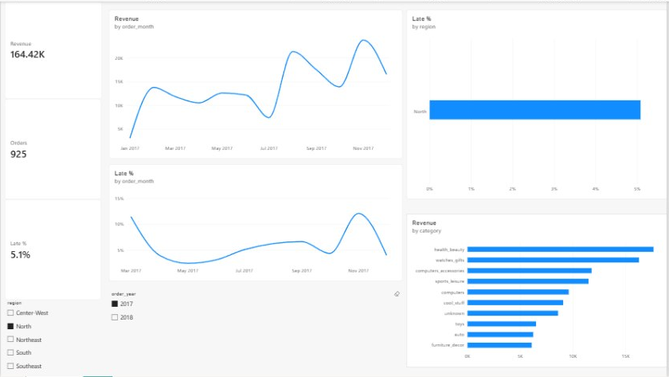
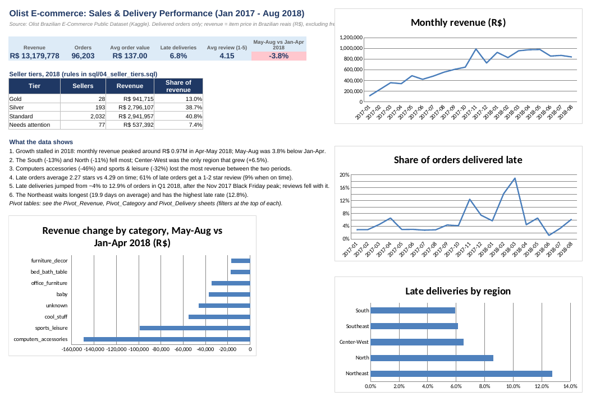

# Olist e-commerce: why did sales go flat in 2018?

This project looks at about 100,000 real orders from Olist, a Brazilian online marketplace. The analysis is done in MySQL, and the results are in an Excel workbook with a dashboard and pivot tables.

Olist's sales grew quickly through 2017 and then stopped growing in 2018. I wanted to find out where the slowdown came from, and whether anything else in the data pointed to a problem.

## Data

[Brazilian E-Commerce Public Dataset by Olist](https://www.kaggle.com/datasets/olistbr/brazilian-ecommerce) on Kaggle (licence CC BY-NC-SA 4.0).

I only used orders that were delivered and placed between January 2017 and August 2018. That's 96,203 orders, 109,872 items and 2,945 sellers. 2016 and September–October 2018 have almost no orders in the dataset, so I left them out. "Revenue" here means the item price in Brazilian reais (R$), not counting freight.

## What I found

**Sales really did stall.** Monthly revenue went from about R$ 112k in January 2017 to roughly R$ 975k in April–May 2018, then started slipping. May–August 2018 was 3.8% lower than January–April.

**The drop wasn't the same everywhere.** The South fell 13% and the North 11%, while Center-West was the only region that grew (+6.5%). By product, computers accessories lost 46% of its revenue between those two periods and sports & leisure lost 32%.

**Late deliveries hurt reviews badly.** Late orders get an average review of 2.27 stars, compared with 4.29 when the order arrives on time. 61% of late orders get a 1 or 2 star review, against 9% of on-time orders.

**Delivery fell apart after Black Friday.** Late deliveries went from about 4% of orders to 12.9% in the first quarter of 2018, and the average review dropped to 3.94. Both recovered the following quarter.

**The Northeast gets the worst service:** 19.9 days to deliver on average and 12.8% late, compared with 10.7 days and 6.1% in the Southeast.

Revenue is also very concentrated: the top 10% of sellers bring in 67% of it.

## Follow-up: two questions the first round left open

These are in `sql/05_follow_up.sql`.

**Are slow deliveries in the North and Northeast the sellers' fault?** No. Sellers take about the same time everywhere to hand an order to the carrier (2.6–2.8 days). The difference is the carrier leg: 19.2 days to the North and 16.6 days to the Northeast, against 7.5 days inside the Southeast. Between 66% and 73% of items in every region are shipped by sellers in São Paulo state, so customers far from São Paulo are mostly waiting on long-distance shipping. Better carrier options for those regions would help more than pushing sellers.

**Did the shrinking categories lose sellers or buyers?** Buyers. Both categories had *more* active sellers in May–August than in January–April (computers accessories 139 → 149, sports & leisure 241 → 267), and prices only dropped slightly. But orders fell by 39% and 28%.

## Seller tiers

`sql/04_seller_tiers.sql` puts every 2018 seller into a tier with one `CASE` rule. The conditions are checked in this order:

1. **Needs attention:** 10+ orders, and an average review below 3.5 or 20%+ of orders late
2. **Gold:** R$ 15,000+ revenue, review 4.2+, under 8% late
3. **Silver:** R$ 5,000+ revenue, review 4.0+
4. **Standard:** everyone else

77 sellers end up in "Needs attention", covering 7.4% of 2018 revenue. Those are the ones worth a call.

## Power BI dashboard

`excel/Olist_Sales_Dashboard.pbix` (built in Power BI Desktop from the `Sales_Data` sheet)


*(screenshot filtered to the North region, 2017)*

Three DAX measures drive every chart:

```
Revenue = SUM(Sales_Data[price])
Orders  = DISTINCTCOUNT(Sales_Data[order_id])
Late %  = DIVIDE(CALCULATE([Orders], Sales_Data[delivery_status] = "Late") + 0, [Orders])
```

Region and year slicers filter all the charts at once. With no filters selected, the cards match the SQL results: R$ 13,179,778 revenue, 96,203 orders, 6.8% late.

## Excel workbook

`excel/Olist_Sales_Dashboard.xlsx`



- **Dashboard:** KPI cards, the seller tier table and four charts
- **Pivot_Revenue:** revenue by month and region, with category and delivery-status filters
- **Pivot_Category:** revenue by category and year, with a region filter
- **Pivot_Delivery:** average review by delivery status, with region and year filters
- **Sales_Data:** one row per item sold (the source for the pivot tables)
- the remaining sheets hold query results exported from MySQL

## Running it

You need MySQL 8 and Python 3.10+.

1. Download the dataset from Kaggle into `data/` (see `data/README.md`).
2. Load it:
   ```bash
   pip install -r requirements.txt
   cp .env.example .env              # put your MySQL user and password in .env
   mysql -u root -p < sql/01_schema.sql
   python load_data.py
   mysql -u root -p < sql/02_analysis_tables.sql
   ```
3. Run the analysis, or open the files in MySQL Workbench:
   ```bash
   mysql -u root -p -t < sql/03_analysis.sql
   mysql -u root -p -t < sql/04_seller_tiers.sql
   mysql -u root -p -t < sql/05_follow_up.sql
   ```

`02_analysis_tables.sql` builds real tables with indexes rather than views. Joining views of grouped data was far too slow.
